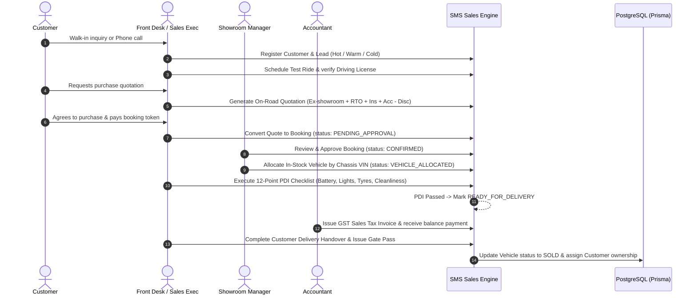
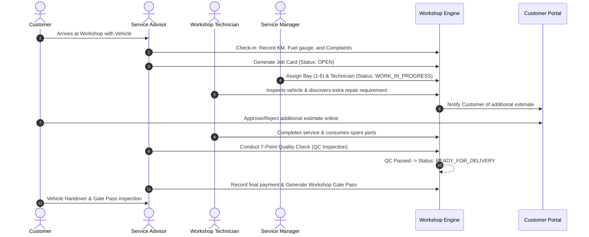
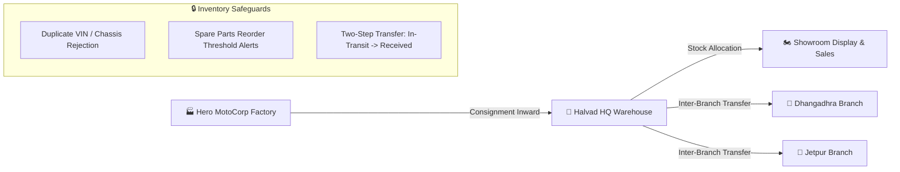
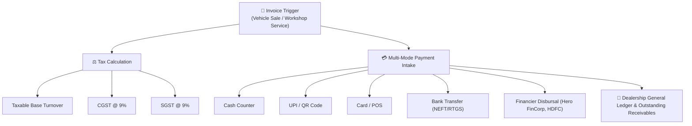
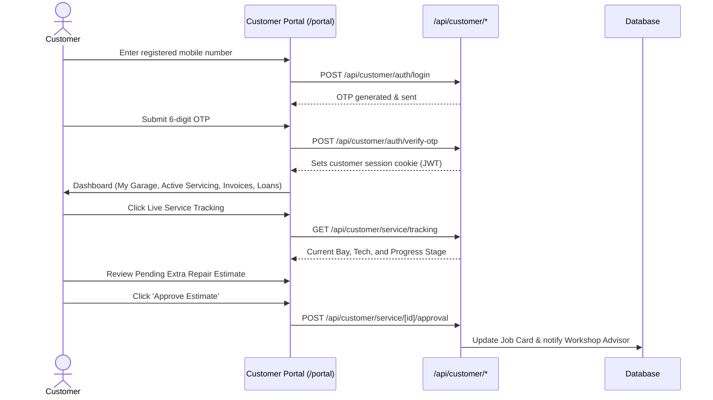

# 🏍️Showroom Management System (SMS)

[](https://nextjs.org/)
[](https://www.typescriptlang.org/)
[](https://tailwindcss.com/)
[](https://www.prisma.io/)
[](https://supabase.com/)
[](./LICENSE)

An enterprise-grade, full-stack **Dealership Management System (ERP)** and **Customer Self-Service Portal** designed specifically for authorized **Hero MotoCorp** two-wheeler dealerships. Built with Next.js 14 App Router, TypeScript, Prisma ORM, and PostgreSQL (Supabase).

---

## 📌 Table of Contents

- [Overview](#-overview)
- [System Architecture](#-system-architecture)
  - [High-Level Architectural Diagram](#high-level-architectural-diagram)
  - [Layered Architecture Breakdown](#layered-architecture-breakdown)
- [How the System Works (End-to-End Workflows)](#-how-the-system-works-end-to-end-workflows)
  - [1. Vehicle Sales & Customer Delivery Lifecycle](#1-vehicle-sales--customer-delivery-lifecycle)
  - [2. Workshop Service & 6-Bay Floor Lifecycle](#2-workshop-service--6-bay-floor-lifecycle)
  - [3. Inventory, VIN Tracking & Inter-Branch Transfers](#3-inventory-vin-tracking--inter-branch-transfers)
  - [4. Finance, Invoicing & GST Accounting](#4-finance-invoicing--gst-accounting)
  - [5. Customer Self-Service Portal Flow](#5-customer-self-service-portal-flow)
- [Key Features & Modules](#-key-features--modules)
  - [1. Role-Based Dealership ERP](#1-role-based-dealership-erp)
  - [2. Customer Self-Service Portal](#2-customer-self-service-portal)
- [Technology Stack](#-technology-stack)
- [Database Schema (Prisma & PostgreSQL)](#-database-schema-prisma--postgresql)
- [Security & RBAC Protection](#-security--rbac-protection)
- [Directory Structure](#-directory-structure)
- [Getting Started](#-getting-started)
  - [Prerequisites](#prerequisites)
  - [Installation & Setup](#installation--setup)
- [License](#-license)

---

## 🌟 Overview

The **Showroom Management System** unifies all commercial, technical, and customer-facing operations across multiple authorized branches:

- **Halvad Main Branch (HQ)** — `SHR-HLV`
- **Dhangadhra Branch** — `SHR-DHN`
- **Jetpur Branch** — `SHR-JTP`

It eliminates paperwork and fragmented spreadsheets by consolidating Sales, CRM, Test Rides, Workshop & Service Bays, GST Invoicing, Inventory & VIN Tracking, Finance & Loans, and Customer Communication into a unified, high-performance platform.

---

## 🏗️ System Architecture

The system is engineered using a modern, multi-tier full-stack architecture built on Next.js 14 (App Router), TypeScript, Prisma ORM, and PostgreSQL. It delivers zero-latency operations for showroom employees while providing public self-service capabilities for customers.

### High-Level Architectural Diagram

```mermaid
flowchart TD
    subgraph ClientLayer["🖥️ Presentation & Client Layer"]
        A1["Dealership Staff ERP<br/>(8 Role-Based Dashboards)"]
        A2["Customer Mobile Portal<br/>(OTP Passwordless Auth)"]
    end

    subgraph SecurityLayer["🛡️ Edge Routing & Security Layer"]
        B1["Next.js Edge Middleware (middleware.ts)"]
        B2["Session & JWT Engine (jose / HS256)"]
        B3["Route RBAC Guards (ROUTE_PERMISSIONS)"]
        B4["HttpOnly Secure Cookie Store"]
    end

    subgraph AppLayer["⚙️ Application & API Service Layer (Next.js 14)"]
        C1["App Router Server & Client Components"]
        C2["REST API Route Handlers (/api/*)"]
        C3["Zod Input Validation Engine"]
        C4["Granular Permission & Branch Access Guards"]
        C5["Audit Logging & Secret Scrubbing Service"]
    end

    subgraph DomainModules["📦 Business Domain Engines"]
        D1["Sales & Booking Engine<br/>(Quotation, VIN Allocation, PDI)"]
        D2["Workshop & Service Engine<br/>(6-Bay Matrix, Job Cards, QC)"]
        D3["Inventory & Logistics Engine<br/>(Inward, VIN Tracking, Transfers)"]
        D4["Finance & GST Engine<br/>(Invoicing, Multi-Mode Payments, Loans)"]
        D5["CRM & Customer Engine<br/>(Leads, 360 Profiles, Test Rides)"]
    end

    subgraph DataLayer["🗄️ Persistence & Database Layer"]
        E1["Prisma ORM 5.22 (Client Singleton)"]
        E2["PostgreSQL Database (Supabase)"]
        E3["25+ Relational Models with B-Tree Indexes & Constraints"]
    end

    ClientLayer --> SecurityLayer
    SecurityLayer --> AppLayer
    AppLayer --> DomainModules
    DomainModules --> DataLayer
```



### Layered Architecture Breakdown

1. **Presentation & Client Layer**:
   - **Internal ERP**: Tailored UI views for 8 specific dealership roles (`ADMIN`, `SHOWROOM_MANAGER`, `SALES_EXECUTIVE`, `FRONT_DESK`, `SERVICE_MANAGER`, `SERVICE_ADVISOR`, `ACCOUNTANT`, `INVENTORY_MANAGER`).
   - **Customer Portal**: Mobile-first client application for bike owners to view their vehicles, live service stage, digital bills, and approvals.
   - Built with **React 18**, **Tailwind CSS 3.4**, and **Lucide Icons** implementing a custom Hero MotoCorp design system.

2. **Edge Routing & Security Layer**:
   - **Next.js Edge Middleware (`src/middleware.ts`)**: Intercepts every HTTP request before execution.
   - **JWT Engine (`jose`)**: Issues and cryptographically verifies `HS256` signed JSON Web Tokens stored inside `httpOnly`, `SameSite=Lax`, secure cookies.
   - **Route-Level RBAC**: Automatically redirects unauthorized roles to `/unauthorized` and unauthenticated sessions to `/login`.

3. **Application & API Service Layer**:
   - **App Router Route Handlers (`src/app/api/*`)**: 85+ validated API endpoints handling CRUD operations and domain workflows.
   - **Zod Schema Validation**: Every API payload is strictly validated before hitting business logic.
   - **Two-Tier Authorization**: Endpoint-level permission guards (`requirePermission`, `requireBranchAccess`) ensuring multi-tenant branch data isolation.
   - **Audit Trail**: Every authentication attempt, permission modification, and major transaction is sanitized and recorded.

4. **Business Domain Engines**:
   - Encapsulates discrete showroom business logic: on-road price computations, duplicate VIN checks, 6-bay workshop status machines, loan disbursal reconciliation, and GST tax splits.

5. **Persistence & Data Layer**:
   - **Prisma ORM**: Manages schema definitions, migrations, typed relation joins, and transactions.
   - **PostgreSQL**: Cloud-hosted relational database featuring primary/foreign key referential integrity, unique constraints (VIN, Engine No, Invoice No), and B-Tree indexes on query-intensive fields.

---

## 🔄 How the System Works (End-to-End Workflows)

The system manages the entire operational lifecycle of a Hero MotoCorp dealership across 5 primary workflows:

---

### 1. Vehicle Sales & Customer Delivery Lifecycle



#### Detailed Steps:
1. **Inquiry & Lead Capture**: Front Desk logs visitor contact details, preferred Hero model, and lead priority.
2. **Test Ride Verification**: Sales Consultant registers a demo ride with driving license validation and captures feedback.
3. **Quotation Builder**: Automatic on-road price calculator computes Ex-Showroom + RTO Registration + Comprehensive Insurance + Accessories minus discounts, along with estimated financier EMIs.
4. **Booking & Approval**: Token deposit (Cash/UPI) registers the booking. The Showroom Manager approves commercial terms.
5. **Chassis & VIN Allocation**: Physical vehicle from showroom stock is locked to the booking using its unique 17-character VIN and Engine Number.
6. **Pre-Delivery Inspection (PDI)**: Technicians execute a 12-point inspection (electricals, battery voltage, tyre pressures, fluid levels, toolkit).
7. **Invoicing & Delivery**: The Accountant generates the formal GST Tax Invoice, records final payment, and prints the vehicle Gate Pass for handover.

---

### 2. Workshop Service & 6-Bay Floor Lifecycle



#### Detailed Steps:
1. **Reception Check-In**: Service Advisor inspects incoming vehicle, logs current odometer, fuel gauge, inventory checklist, and customer complaints.
2. **Job Card Generation**: Creates digital job ticket with initial service estimate (labor + parts).
3. **Bay & Technician Allocation**: Service Manager assigns the vehicle to one of 6 physical bays (`Bay 1` to `Bay 6`) based on bay specialization and technician workload.
4. **Customer Approval for Extra Work**: If unexpected wear (e.g. clutch plate, brake shoe) is detected, an estimate is sent. The customer approves it directly from the **Customer Portal** or via phone.
5. **Quality Control (QC)**: Post-service, the vehicle undergoes a 7-point road-test and torque check before being certified.
6. **Billing & Gate Pass**: Itemized service invoice is generated with automatic GST calculation; gate pass is printed for security clearance at exit.

---

### 3. Inventory, VIN Tracking & Inter-Branch Transfers



#### Detailed Steps:
1. **Consignment Inward**: When trucks arrive from the factory, vehicles are scanned into stock. The system verifies that the VIN and Engine numbers are globally unique.
2. **Spare Parts Reorder Monitoring**: High-turnover consumables (engine oil, filters, spark plugs, brake pads) have automated minimum-stock triggers warning the Inventory Manager when stock runs low.
3. **Inter-Branch Transfers**: If Dhangadhra or Jetpur needs a specific color or model variant, a transfer request is created (`REQUESTED` ➔ `IN_TRANSIT` ➔ `RECEIVED`), ensuring complete traceability of all company assets across branches.

---

### 4. Finance, Invoicing & GST Accounting



#### Detailed Steps:
1. **Automatic GST Splitting**: Every bill computes taxable value and automatically splits GST into **CGST 9%** and **SGST 9%** (18% total) or applicable rates for commercial vehicle billing.
2. **Split & Partial Payments**: Invoices support split payments across multiple payment methods (e.g., ₹20,000 via UPI + ₹65,000 via Financier disbursal).
3. **Financier Disbursal Tracking**: Auto loans from partnered banks (Hero FinCorp, HDFC, L&T) are tracked from application submission through approved payout, directly crediting the customer's vehicle invoice.
4. **Aging Receivables**: Tracks overdue customer accounts by days overdue (Current, 1-30 days, 30+ days) with one-click payment collection.

---

### 5. Customer Self-Service Portal Flow



#### Detailed Steps:
1. **Zero-Friction Authentication**: Customers log in securely using their phone number without needing to remember passwords.
2. **Digital Garage**: View registered Hero motorcycles, engine specifications, registration numbers, and active warranties.
3. **Real-Time Bay Tracker**: Transparency into workshop progress (`CHECKED_IN` ➔ `INSPECTION` ➔ `WORK_IN_PROGRESS` ➔ `QUALITY_CHECK` ➔ `READY_FOR_PICKUP`).
4. **Self-Service Actions**: Instant approval/rejection of workshop repair estimates, viewing EMI payment schedules, and downloading official tax invoices.

---

## 🚀 Key Features & Modules

### 1. Role-Based Dealership ERP

The internal ERP provides 8 dedicated, permission-locked role dashboards:

| Role | Module Capabilities |
| :--- | :--- |
| **👑 Franchise Principal / Admin** | Executive financial metrics, cross-branch revenue targets, staff provisioning & deactivation, comprehensive audit logs, and global settings. |
| **🏢 Showroom Manager** | Booking approvals, physical VIN allocations, branch sales target monitoring, and inventory supervision. |
| **💼 Sales Executive** | Customer lead management (Hot / Warm / Cold), automated On-Road Quotation builder (Ex-Showroom + RTO + Insurance + Accessories - Discount), test ride scheduling, and 12-point PDI delivery handovers. |
| **🛎️ Front Desk / Reception** | Walk-in visitor registry, inquiry tracking, customer assignment, and test ride intake. |
| **🔧 Service Manager** | 6-Bay live workshop tracker, technician job allocation, service revenue analytics, and spare part usage reports. |
| **📋 Service Advisor** | Customer vehicle check-in, job card generation, complaint logging, additional repair estimates, and 7-point Quality Check (QC) inspection. |
| **💰 Accountant / Finance** | GST tax invoices (CGST 9% + SGST 9%), partial & multi-mode payment receipts (Cash, UPI, Bank Transfer, Cheque), Financier loan disbursals (Hero FinCorp, HDFC), and receivables ledger. |
| **📦 Inventory Manager** | Consignment inward with strict duplicate VIN/Chassis safeguards, spare parts stock thresholds, and inter-branch stock transfers. |

---

### 2. Customer Self-Service Portal

A dedicated, mobile-first customer portal allowing bike owners to manage their vehicle lifecycle:

- 📱 **Passwordless Mobile OTP Login**: Fast login using verified phone numbers.
- 🏍️ **My Hero Garage**: View registered bikes, engine numbers, VINs, and warranty validity.
- 🔴 **Live Workshop Tracker**: Real-time bay-by-bay progress tracking for active vehicle servicing (`CHECKED_IN` ➔ `IN_SERVICE` ➔ `QC_INSPECTION` ➔ `READY_FOR_DELIVERY`).
- ✍️ **Estimate Approvals**: One-click approval/rejection for additional repair estimates requested by workshop technicians.
- 🧾 **Digital Invoices & Receipts**: View and download itemized GST bills and payment records.
- 💳 **Loan & EMI Schedule**: Monitor financed loan balance, monthly installments, and upcoming dues.

---

## 💻 Technology Stack

- **Frontend & Full-Stack Framework**: [Next.js 14](https://nextjs.org/) (App Router, Server Components & Route Handlers)
- **Language**: [TypeScript 5.7+](https://www.typescriptlang.org/) (100% strict type safety)
- **Styling**: [Tailwind CSS 3.4](https://tailwindcss.com/) with Custom Hero MotoCorp Design System (HSL color tokens, glassmorphism, responsive micro-animations)
- **Database**: [PostgreSQL](https://www.postgresql.org/) hosted on [Supabase](https://supabase.com/)
- **ORM & Data Layer**: [Prisma ORM 5.22](https://www.prisma.io/) (25+ relational models)
- **Icons**: [Lucide React](https://lucide.dev/)
- **Schema Validation**: [Zod 3.24](https://zod.dev/)
- **Authentication**: Cryptographic JSON Web Tokens (JWT) signed via `jose`, stored in `httpOnly` `SameSite=Lax` secure cookies
- **Password Security**: [Bcrypt.js](https://github.com/dcodeIO/bcrypt.js) with 10 salt rounds

---

## 🗄️ Database Schema (Prisma & PostgreSQL)

The schema in `prisma/schema.prisma` models complete enterprise operations across **25+ relational entities**:

```text
├── User (Staff & Roles)
├── Branch (Multi-location tenancy)
├── Customer (CRM profiles & KYC)
├── CustomerVehicle (Vehicle ownership ledger)
├── Lead (Sales pipeline & follow-ups)
├── TestRide (Demo booking & license verification)
├── Quotation (On-road pricing engine)
├── Booking (Token booking & manager approvals)
├── VehicleUnit (Physical stock, VIN, Chassis & Engine numbers)
├── PDIChecklist (12-point pre-delivery inspection)
├── Delivery (Handover & registration)
├── JobCard (Workshop service tickets)
├── JobCardItem (Labor & parts line items)
├── Invoice (GST tax invoices & billing)
├── Payment (Multi-method receipts & reconciliations)
├── SparePart (Parts inventory & min-stock thresholds)
├── StockMovement (Consignment inward & inter-branch transfer)
├── Notification (User & branch alerts)
└── AuditLog (Security & compliance trail with secret scrubbing)
```

---

## 🔒 Security & RBAC Protection

- **Server-Authoritative RBAC**: Role verification is strictly enforced on the server. Client-side role claims are validated against the database.
- **IDOR Protection**: Customers are cryptographically isolated (`isCustomer: true`); cross-customer record access is strictly forbidden (`403/404`).
- **Data Scrubbing**: Passwords, hashes, and JWT tokens are automatically stripped from audit logs before persistence.
- **Sanitized Error Responses**: Production error handlers return clean JSON without leaking filesystem paths, database connection strings, or stack traces.
- **Duplicate VIN Safeguard**: Inward stock movements strictly reject duplicate VIN or Chassis numbers to prevent inventory anomalies.

---

## 📁 Directory Structure

```text
shreeji-hero-sms/
├── prisma/
│   ├── schema.prisma              # 25+ relational PostgreSQL models
│   └── seed.ts                    # Production baseline seed script
├── public/                        # Static assets, branding logos & media
├── src/
│   ├── app/
│   │   ├── (auth)/                # Staff authentication (/login, /signup)
│   │   ├── (customer)/            # Customer Portal (/portal, /portal/login)
│   │   ├── (erp)/                 # Dealership ERP modules
│   │   │   ├── dashboard/         # Role-aware dashboard
│   │   │   ├── leads/             # Lead management & pipeline
│   │   │   ├── test-rides/        # Test ride booking & schedules
│   │   │   ├── sales/             # Quotations, bookings & delivery
│   │   │   ├── service/           # Workshop & 6-bay tracker
│   │   │   ├── inventory/         # Stock, spare parts & inward
│   │   │   ├── finance/           # Invoicing, payments & GST reports
│   │   │   ├── customers/         # CRM customer directory
│   │   │   ├── employees/         # Staff provisioning & status
│   │   │   ├── reports/           # Analytics & branch exports
│   │   │   ├── notifications/     # Real-time alerts
│   │   │   └── settings/          # Provider & branch configuration
│   │   ├── api/                   # 85 Next.js App Router API endpoints
│   │   ├── globals.css            # Tailwind design system & tokens
│   │   ├── layout.tsx             # Root layout with font optimization
│   │   └── page.tsx               # Public showroom landing page
│   ├── components/
│   │   ├── dashboard/             # 8 Role-specific dashboard views
│   │   ├── layout/                # AppShell, Sidebar, TopHeader
│   │   └── ui/                    # Design system components (Card, Button, Modal, etc.)
│   ├── hooks/                     # Custom React hooks
│   ├── lib/
│   │   ├── auth/                  # JWT token signing & cookies
│   │   ├── db/                    # Data stores, fixtures & Prisma singleton
│   │   ├── audit.ts               # Security audit logger
│   │   ├── constants.ts           # Dealership branches & vehicle catalogue
│   │   ├── permissions.ts         # Granular RBAC permission matrix
│   │   ├── prisma.ts              # Global PrismaClient singleton
│   │   └── utils.ts               # Currency formatting (INR), dates & classnames
│   ├── scripts/
│   │   └── migrate-users-to-postgres.ts # User migration script
│   ├── types/                     # TypeScript domain models & interfaces
│   └── middleware.ts              # Route protection & session validation
├── .env.example                   # Environment configuration template
├── .gitignore                     # Git ignore rules (protects backend & secrets)
├── next.config.mjs                # Next.js configuration
├── package.json                   # Project dependencies & scripts
├── tailwind.config.ts             # Tailwind design tokens & Hero branding
└── tsconfig.json                  # TypeScript compiler settings
```

---

## 🚦 Getting Started

### Prerequisites

- [Node.js](https://nodejs.org/) (v18.17.0 or higher recommended)
- A [Supabase](https://supabase.com/) PostgreSQL database instance (or local PostgreSQL)

---

### Installation & Setup

1. **Clone the repository**:
   ```bash
   git clone https://github.com/your-username/shreeji-hero-sms.git
   cd shreeji-hero-sms
   ```

2. **Install dependencies**:
   ```bash
   npm install
   ```

3. **Configure environment variables**:
   Create a `.env.local` file in the root directory (refer to [.env.example](.env.example)):
   ```bash
   cp .env.example .env.local
   ```
   Add your Supabase PostgreSQL connection string and a secure `JWT_SECRET`.

4. **Push database schema to Supabase / PostgreSQL**:
   ```bash
   npx prisma db push
   ```

5. **Seed baseline branches and initial admin account**:
   ```bash
   npx tsx prisma/seed.ts
   ```

6. **Start the local development server**:
   ```bash
   npm run dev
   ```
   Open [http://localhost:3000](http://localhost:3000) in your browser.

---

## 📄 License

This project is proprietary and confidential. Developed for **Shreeji Hero MotoCorp Authorized Dealership**. All rights reserved.
